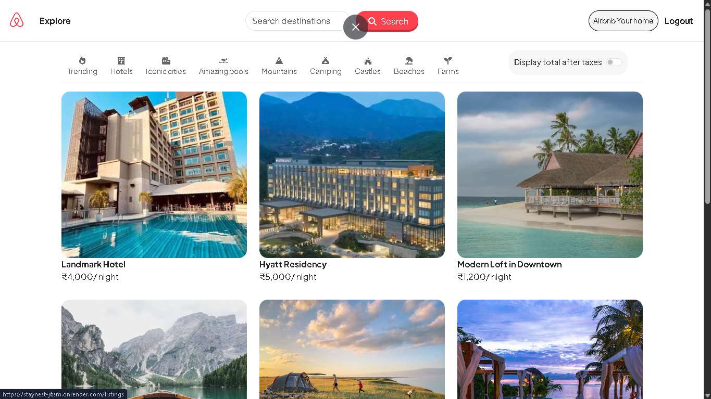
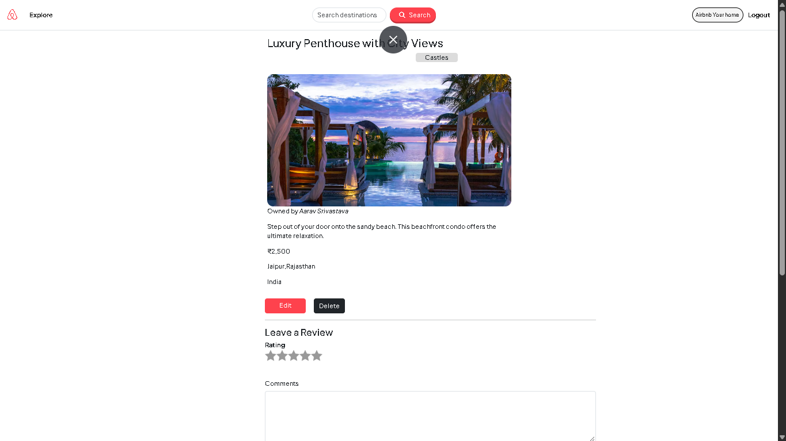
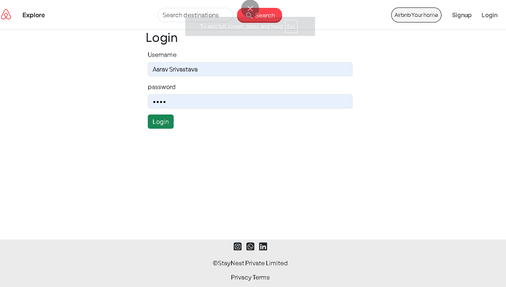
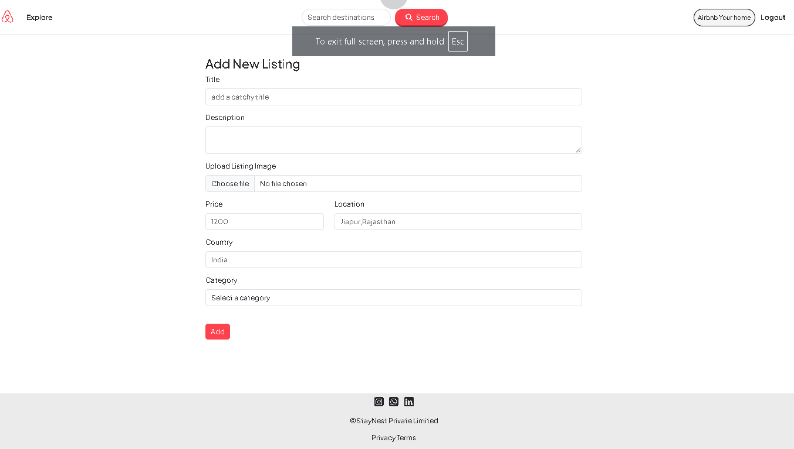
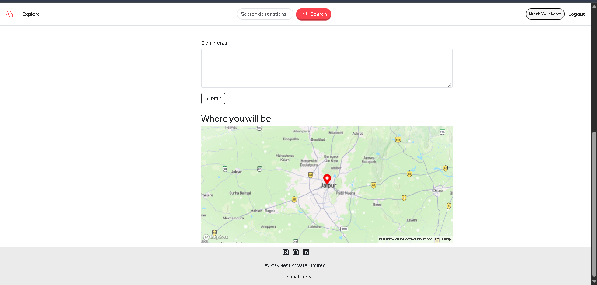
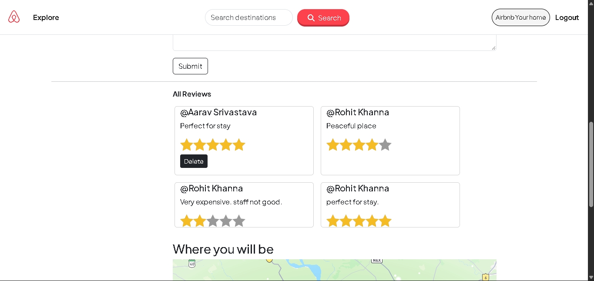

# 🏡 StayNest

A full-stack property listing web application inspired by Airbnb, built with **Node.js, Express, MongoDB, Mongoose, EJS, Passport.js, Cloudinary, and Mapbox**.

StayNest allows users to discover and search properties, create accounts, add and manage their own listings, upload property images, view locations on an interactive map, and leave reviews and ratings.

## 🚀 Live Demo

**Live Website:** https://staynest-j6sm.onrender.com
**GitHub Repository:** https://github.com/aarav753/StayNest

---
## 📸 Screenshots

### 🏠 Listings Page



### 🏡 Listing Details



### 🔐 Login



### ➕ Create Listing



### 🗺️ Location Map



### 🗺️ Reviews



## ✨ Features

### 🏠 Property Listings

- Browse all available property listings.
- View detailed information about each property.
- Add new property listings.
- Edit your own listings.
- Delete your own listings.
- Display property title, description, price, location, country, image, owner, and category.
- Automatically validate listing data before saving.

### 🔎 Search

- Search listings by title.
- Case-insensitive search using MongoDB regular expressions.
- Displays a flash message when no matching listing is found.

### 🗂️ Category Filtering

Listings can be explored through different categories:

- 🔥 Trending
- 🏨 Hotels
- 🏙️ Iconic Cities
- 🏊 Amazing Pools
- ⛰️ Mountains
- ⛺ Camping
- 🏰 Castles
- 🏖️ Beaches
- 🌾 Farms

Each category has its own route and displays matching listings.

### 👤 User Authentication

- User registration and login using Passport.js.
- Password authentication handled with `passport-local-mongoose`.
- Persistent login sessions using Express Session.
- Sessions stored in MongoDB using `connect-mongo`.
- Logout functionality.
- Flash messages for login, logout, signup, and errors.

### 🔐 Authorization

Users can only modify their own listings.

The application checks:

- Whether a user is logged in before protected operations.
- Whether the logged-in user owns a listing before editing or deleting it.
- Whether the logged-in user is the author of a review before deleting it.

Unauthorized users are redirected with an appropriate flash message.

### ⭐ Reviews & Ratings

Authenticated users can:

- Add reviews to listings.
- Give ratings from 1–5 stars.
- View reviews and review authors.
- Delete their own reviews.

Reviews are stored separately in MongoDB and referenced from listings using Mongoose relationships.

### ☁️ Cloudinary Image Uploads

Property images are uploaded using:

- Multer
- Cloudinary
- `multer-storage-cloudinary-v2`

Images are stored remotely on Cloudinary instead of the application server.

### 🗺️ Mapbox Integration

Each listing stores geographic coordinates generated through Mapbox geocoding.

The listing detail page displays:

- An interactive Mapbox map.
- The listing's location.
- A map marker.
- A popup containing the listing title.
- A message that the exact location is provided after booking.

### 💰 Tax Display

The listings page includes a tax toggle that allows users to display an additional:

```text
+18% GST
```

next to listing prices.

### 📱 Responsive Interface

The frontend uses:

- Bootstrap 5
- Custom CSS
- Font Awesome
- Google Fonts
- Responsive navigation
- Responsive listing cards
- Mobile category navigation

### ⚠️ Validation & Error Handling

The application uses **Joi** for server-side validation of:

- Listing data
- Review data

It also includes:

- Custom `ExpressError` class.
- Async error handling through `wrapasync`.
- Custom 404 page.
- Flash messages for user feedback.

---

## 🛠️ Tech Stack

### Backend

- **Node.js**
- **Express.js**
- **Mongoose**
- **MongoDB Atlas**
- **Passport.js**
- **Passport Local**
- **Express Session**
- **Connect Mongo**
- **Connect Flash**
- **Joi**

### Frontend

- **EJS**
- **EJS-Mate**
- **HTML5**
- **CSS3**
- **Bootstrap 5**
- **JavaScript**
- **Font Awesome**

### APIs & Cloud Services

- **MongoDB Atlas** — database
- **Cloudinary** — image storage
- **Mapbox** — geocoding and interactive maps

### Other Libraries

- **Multer** — handling multipart/form-data and image uploads
- **Method Override** — PUT/DELETE requests from HTML forms
- **dotenv** — environment variables

---

## 📁 Project Structure

```text
StayNest/
│
├── app.js
├── package.json
├── package-lock.json
├── cloudConfig.js
├── middleware.js
├── schema.js
│
├── controllers/
│   ├── listingcategory.js
│   ├── listings.js
│   ├── reviews.js
│   └── users.js
│
├── models/
│   ├── listing.js
│   ├── reviews.js
│   └── user.js
│
├── routes/
│   ├── listing.js
│   ├── review.js
│   └── user.js
│
├── utils/
│   ├── ExpressError.js
│   └── wrapasync.js
│
├── views/
│   ├── error.ejs
│   │
│   ├── includes/
│   │   ├── flash.ejs
│   │   ├── footer.ejs
│   │   └── navbar.ejs
│   │
│   ├── layouts/
│   │   └── boilerplate.ejs
│   │
│   ├── listings/
│   │   ├── index.ejs
│   │   ├── new.ejs
│   │   ├── show.ejs
│   │   └── edit.ejs
│   │
│   └── user/
│       ├── login.ejs
│       └── signup.ejs
│
├── public/
│   ├── css/
│   │   ├── style.css
│   │   └── rating.css
│   │
│   ├── js/
│   │   ├── map.js
│   │   └── script.js
│   │
│   └── image.png
│
└── init/
    ├── data.js
    └── index.js
```

---

## 🔄 Application Architecture

The application follows a structured MVC-style architecture.

```text
                    User
                     │
                     ▼
                 Express.js
                     │
          ┌──────────┼──────────┐
          ▼          ▼          ▼
        Routes   Middleware   Passport
          │          │          │
          └──────────┼──────────┘
                     ▼
                Controllers
                     │
                     ▼
                  Models
                     │
                     ▼
                Mongoose
                     │
                     ▼
              MongoDB Atlas
```

External services are integrated separately:

```text
Express Application
       │
       ├── MongoDB Atlas
       │       └── Users, Listings, Reviews, Sessions
       │
       ├── Cloudinary
       │       └── Listing Images
       │
       └── Mapbox
               └── Geocoding + Maps
```

---

## 🔐 Environment Variables

Create a `.env` file in the project root.

```env
ATLASDB_URL=your_mongodb_atlas_connection_string

SECRET=your_session_secret

CLOUD_NAME=your_cloudinary_cloud_name
CLOUD_API_KEY=your_cloudinary_api_key
CLOUD_API_SECRET=your_cloudinary_api_secret

MAP_TOKEN=your_mapbox_access_token
```

### Important

Never commit `.env` to GitHub.

The repository already includes `.env` in `.gitignore`.

For deployment, these values should be added as environment variables in the hosting platform rather than uploaded to GitHub.

---

## ⚙️ Installation

Clone the repository:

```bash
git clone https://github.com/aarav753/StayNest.git
```

Move into the project directory:

```bash
cd StayNest
```

Install dependencies:

```bash
npm install
```

Create your `.env` file and add the required environment variables.

Start the application:

```bash
node app.js
```

For development with Nodemon:

```bash
nodemon app.js
```

The application runs locally on:

```text
http://localhost:8080
```

---

## 🗄️ Database

StayNest uses **MongoDB Atlas** as its cloud database.

The main collections/models are:

```text
User
Listing
Review
Session
```

### Listing relationships

A listing contains a reference to its owner:

```text
Listing → User
```

and references multiple reviews:

```text
Listing → Reviews
```

Reviews also reference their authors:

```text
Review → User
```

Mongoose `populate()` is used to retrieve related owner and review-author information.

---

## 🔑 Authentication Flow

StayNest uses Passport.js with a local authentication strategy.

```text
Signup
  ↓
User registered with passport-local-mongoose
  ↓
Automatic login
  ↓
Session created
  ↓
Session stored in MongoDB Atlas
```

For login:

```text
Login Form
   ↓
Passport Local Strategy
   ↓
User Authentication
   ↓
Session
   ↓
MongoDB
```

Protected routes use authentication middleware to ensure only logged-in users can perform restricted actions.

---

## 🛡️ Authorization Flow

For listing modifications:

```text
User requests Edit/Delete
          ↓
Is user logged in?
          ↓
        Yes
          ↓
Does user own the listing?
          ↓
        Yes
          ↓
      Operation
```

If the user does not own the listing, the application prevents the operation and redirects them back to the listing.

The same ownership concept is applied to review deletion.

---

## 🗺️ Location & Geocoding Flow

When a user creates or edits a listing:

```text
Location entered by user
          ↓
       Mapbox
          ↓
Forward geocoding
          ↓
Latitude + Longitude
          ↓
Stored in MongoDB
          ↓
Displayed on Mapbox
```

The listing stores GeoJSON-style Point coordinates, which are then used by the frontend map.

---

## 🖼️ Image Upload Flow

When creating or editing a listing:

```text
Image selected
      ↓
Multer
      ↓
Cloudinary Storage
      ↓
Cloudinary URL
      ↓
Listing document
      ↓
Image displayed on website
```

This keeps uploaded images outside the application server.

---

## 🧹 Sample Data

The `init/` directory contains the original sample-data initialization scripts used during development.

```text
init/
├── data.js
└── index.js
```

The initialization script inserts sample listings into MongoDB.

> ⚠️ The initialization script deletes existing listings before inserting the sample data. It should therefore not be run against a production database unless a full reset is intentionally required.

The normal application does not require the initialization script to run.

---

## 📌 Main Routes

### Listings

```text
GET     /listings
GET     /listings/new
POST    /listings
GET     /listings/:id
GET     /listings/:id/edit
PUT     /listings/:id
DELETE  /listings/:id
POST    /listings/search
```

### Categories

```text
GET /listings/trending
GET /listings/hotels
GET /listings/cities
GET /listings/pools
GET /listings/mountains
GET /listings/camping
GET /listings/castles
GET /listings/beaches
GET /listings/farms
```

### Reviews

```text
POST   /listings/:id/reviews
DELETE /listings/:id/reviews/:reviewId
```

### Authentication

```text
GET  /signup
POST /signup

GET  /login
POST /login

GET  /logout
```

---

## 🎯 Key Concepts Demonstrated

This project demonstrates practical experience with:

- MVC architecture
- RESTful routing
- CRUD operations
- MongoDB and Mongoose
- Mongoose schemas and models
- MongoDB relationships and `populate()`
- User authentication
- Authorization and ownership checks
- Passport.js
- Express sessions
- Persistent sessions with MongoDB
- Flash messages
- Middleware
- Joi validation
- Error handling
- Async/await
- Cloudinary image storage
- Multer file uploads
- Mapbox geocoding
- Interactive maps
- EJS templating
- EJS-Mate layouts
- Bootstrap responsive design
- JavaScript DOM manipulation
- Git and GitHub
- Cloud deployment

---

## 🔮 Future Improvements

Possible improvements for future versions include:

- Booking and reservation functionality
- Availability management
- Date-based price calculation
- User profile pages
- Wishlist/favorites
- Advanced location-based search
- Price range filtering
- Sorting by price and ratings
- Pagination
- Improved mobile UI
- Image optimization
- More detailed review analytics
- Production-grade logging
- Automated testing
- More restrictive production database network access
- Custom domain

---

## 👨‍💻 Author

**Aarav Srivastava**

GitHub:  
https://github.com/aarav753

---

## 📄 License

This project is currently intended as a personal/educational portfolio project.